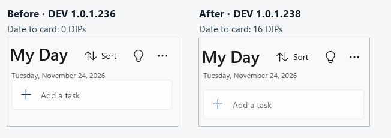

# Try My Day Suggestions in Wintodo DEV

Open the signed x64 MSIX and choose **Update** (or **Install** on a first install). Open **Wintodo DEV** from Start; its icon has a purple DEV badge. An update keeps your DEV tasks. Use the Store app named **Wintodo** only as a visual reference: the two apps have separate local data.

## Check the layout

| What to do | What you should see |
|---|---|
| Open **Tasks**, with the sidebar closed. Compare with the Store app at the same window width and display scale. Then switch to **My Day**. | In Tasks, **Sort** and **…** are one normal button gap apart, with no empty slot between them. In My Day, the lightbulb occupies that slot, even when there are no eligible tasks. |
| In **My Day** with the default sort, look between the date and the top border of **Add a task**. Open Suggestions, narrow the window until it stops, then close Suggestions and widen it again. | The full date remains readable. There is a 16-DIP gap below its last line before the input border at either width, with Suggestions open or closed. The sort, bulb, menu and close controls remain reachable. If My Day itself is empty, its prompt fits inside the left pane. |
| On a fresh DEV profile, open Suggestions before creating any tasks. On an existing profile, you can also see this state when all eligible suggestions have been added or completed. | The sidebar says **You have no suggested tasks.** The message is readable, the close button still works, and closing the panel returns the width to My Day. No need to clear existing data for this check. |
| With enough suggestions to scroll, hover at the far right to expand the scrollbar. Scroll down and click the **right edge of a +** in a newly visible row. Scroll to the bottom. | The scrollbar stays to the right of the button. The click adds exactly that task. The final row can be brought fully into view, and there is no fixed blank band between the scrollable area and the bottom of the window. |

For the scrolling check, a short window needs fewer rows. The [sample calendar](samples/Suggestions-scroll.ics) is also beside the installer. In DEV, choose **Settings → Data → Import .ics**, select **Suggestions-scroll.ics**, and confirm the import. It adds one local list with 24 numbered tasks under **No Due Date**; it requires no account. Import it after checking the empty state.

## Check the actions

Create a local list named **Suggestions test**. Add these tasks **in that list**, because tasks created directly in My Day are already pinned:

| Task | Set its due date to | Where it should appear |
|---|---|---|
| `Overdue sample` | Yesterday, using the calendar | Suggestions → **Earlier** |
| `Future sample` | Tomorrow | Suggestions → **Later** |
| `Undated sample` | Leave it blank | Suggestions → **Recently added** |
| `Today sample` | Today | The main **My Day** list, outside Suggestions |

1. Open **My Day → lightbulb**. Click **+** on **Overdue sample**. It should leave Suggestions and appear in My Day. The sidebar should stay open. Visit **Suggestions test** to confirm the original task is still there.
2. Return to My Day, reopen Suggestions and click the **empty circle** on **Future sample**. It should disappear. With focus outside a text box, press **Ctrl+Z**: the task should return under **Later**.
3. In **Suggestions test**, set **Future sample** to **Repeat → Daily**, keeping tomorrow’s due date. Complete it once in Suggestions. It should stay unfinished and advance exactly one day.
4. Open **Today sample** from the main My Day list. Type a note, immediately click the lightbulb, then reopen the task. The note should still be there. If Wintodo reports that it cannot save, the editor should stay open with your draft.
5. With Suggestions open, press **Esc**, then **Enter**. Focus should return to the bulb and reopen it. The **×** in the sidebar also closes it.
6. With Suggestions open again, use the keyboard to select **Today sample** in the main list. The task details should replace Suggestions. The focus outline should stay with the task instead of jumping back to the lightbulb.

If you already have a disposable CalDAV test calendar on a second device, leave Suggestions open, create an overdue task and complete a different suggestion on that device. After the next successful sync, the first should appear and the second should disappear without reopening the sidebar.

## Why Suggestions feels quicker than task details

Suggestions reveals a panel that already exists and fills its list asynchronously. Each visible row has a title, metadata and two actions. Task details is an editor: before showing a new task it flushes pending edits, loads the task and steps together, and prepares the editing controls. Its opening transition is configured for 200 ms. This explains a difference in perceived speed; it is not a measured timing comparison. The part worth borrowing for details is the immediate frame: once the old draft is safe, show the new panel while its contents load.
